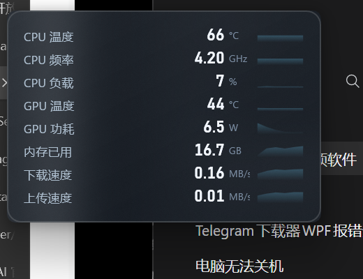
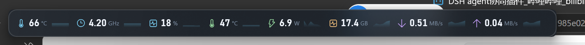
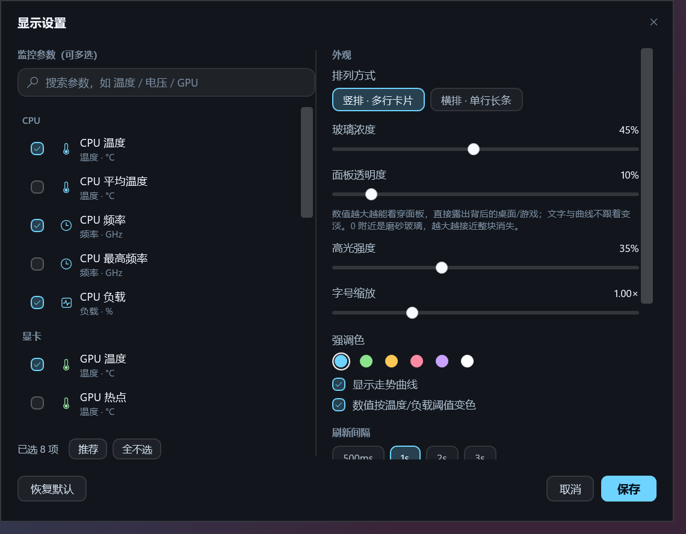
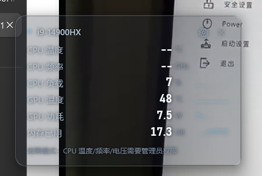

# CpuGlassMonitor · CPU 玻璃监控

透明毛玻璃风格的 CPU/GPU 硬件监控悬浮窗：**温度、频率、核心电压、负载、功耗、显存、内存、上下行网速**都能看，
参数可以自由勾选，窗口可置顶、可锁定、可鼠标穿透，带托盘常驻。

两种排布随参数多少自由切换：**竖排·多行卡片**（默认，适合贴在桌面角落）和**横排·单行长条**
（一栏到底，适合盖在屏幕顶部，参数多时自动折行）；整块面板的透明度也能单独调。

- 界面：WPF 分层窗口（`AllowsTransparency`，自绘 per-pixel alpha）+ Win11 DWM 圆角/暗色模式，
  低透明度区间叠加系统亚克力（`SetWindowCompositionAttribute`）做磨砂
- 采集：LibreHardwareMonitorLib 0.9.4（ring0 驱动读 CPU 温度/频率/电压；GPU 走 NVAPI，不需要驱动）；
  网速由程序自己按网卡累计字节差值算（不依赖驱动，也不需要管理员权限）
- 体积：发布后约 1.6 MB（框架依赖，需要已安装 .NET 10 桌面运行时）
- 语言：C# / net10.0-windows，x64






## 运行

从 [Releases](../../releases) 下载发布包直接运行，或按下面「构建 / 发布」自己编译出发布目录。
需要 **.NET 10 桌面运行时**（Windows 10 1809+ / Windows 11）。

本机实际安装目录是 **`D:\SoftWare\CpuGlassMonitor`**，桌面和开始菜单都有快捷方式。
注意 `D:\bin\WorkSpace\DSH` 这一层被打了低完整性标签，从那下面运行会导致开机自启
读不到 CPU 温度/频率、托盘没图标；项目里的旧 `dist\` 已改名为 `dist  old`，只留作历史产物。
想换目录：设环境变量 `CPUGLASS_HOME` 指向新目录，把文件复制过去，再以管理员运行一次
`fix-autostart.cmd`（可加 `-Target "新路径\CpuGlassMonitor.exe"`），计划任务和快捷方式会一起改。

> **首次启动会弹一次 UAC**。CPU 温度 / 频率 / 核心电压必须走内核驱动（ring0），没有管理员权限时
> 只能读到负载；此时面板底部会显示「受限模式」提示，同意 UAC 即可看到全部数据。
> 不想每次提权：设置里关掉「需要管理员权限」，或者启动时加 `--no-elevate`。

交互：

| 操作 | 效果 |
| --- | --- |
| 拖动面板 | 移动窗口（「锁定位置」后不可拖） |
| 双击面板 | 打开设置 |
| 右键面板 / 托盘图标 | 右键菜单（置顶、锁定、穿透、曲线、横排、自启、隐藏、退出） |
| 托盘图标单击 | 显示/隐藏面板 |
| 托盘菜单「退出」 | 完全退出程序 |

> 面板上**没有标题栏、齿轮和关闭按钮**，只有数据本身——这样能压到最窄，直接当 HUD 用。

每行左侧是**图标而不是文字标签**（温度计 = 温度、钟表 = 频率、折线 = 负载、闪电 = 功耗、内存条 = 容量、
下/上箭头 = 下载/上传），并按分组着色：CPU 青、显卡绿、内存琥珀、网络紫、主板橙。
同一个形状分不清时靠颜色区分钟是 CPU 还是显卡；鼠标悬停会显示完整名称（如「CPU 温度 · 温度 · °C」）。
默认面板宽度因此从 300 缩到 180。
> 设置靠双击面板（或右键菜单「显示设置…」、托盘菜单）；要关掉程序走托盘「退出」。

## 设置面板

左侧是可勾选的监控参数（按 CPU / GPU / 内存分组，支持关键字搜索），右侧是外观与行为：

- 排列方式：竖排·多行卡片 / 横排·单行长条
- 玻璃浓度（5–92%，控制玻璃底色的深浅）、面板透明度（0–92%，= 能看穿多少）、高光强度、字号缩放（0.8–1.6×）、强调色（6 种）
- 显示走势曲线、数值按阈值变色
- 刷新间隔 500ms / 1s / 2s / 3s
- 窗口置顶、锁定位置、鼠标穿透、开机自启、需要管理员权限、显示杂项传感器

「保存」写入配置，「取消」回滚；改动是**实时预览**的。

### 玻璃浓度 vs 面板透明度

两个滑杆管的是不同的事，别混着调：

| 滑杆 | 作用 |
| --- | --- |
| **玻璃浓度** | 玻璃底色本身深不深（深蓝灰 → 近黑），面板有多「沉」 |
| **面板透明度** | 能看穿多少。数值越大，背后的桌面/游戏越清楚，文字与曲线**不跟着变淡** |

透明度走的是**分层窗口的自绘 alpha**，所以是真透明：0 附近是磨砂玻璃（这一档会借系统亚克力做磨砂质感），
往右推会一层层褪掉，到 90% 以上几乎只剩文字浮在桌面上。

> 说明：Windows 有个硬限制——顶层窗口要么用系统亚克力（有真模糊，但透明度被系统锁死），
> 要么用分层窗口（透明度完全可控，但没有系统级模糊）。本程序选的是后者，因此高透明度区间
> 没有真实模糊，只有半透明蒙版；低透明度区间才切到亚克力。

面板透明度 70% 时的效果（背后是浏览器，文字仍清晰）：



## 配置文件

`%APPDATA%\CpuGlassMonitor\`

- `settings.json`：窗口位置/宽度、已选参数、外观与行为
- `app.log`：启动与异常日志（排查问题看这个）

测试时可以设置环境变量 `CPUGLASS_CONFIG_DIR` 指向别的目录，避免污染真实配置。

## 构建 / 发布

```powershell
cd src
dotnet build -c Release                                  # 编译
dotnet publish -c Release -r win-x64 --self-contained false -o ..\dist
```

`src\lib\` 里是直接引用的四个程序集（LibreHardwareMonitorLib、HidSharp、System.Management、System.IO.Ports），
所以**不需要联网还原 NuGet 包**。

调试参数（自动化验证用，正常使用不需要）：

| 参数 | 作用 |
| --- | --- |
| `--selftest` | 不开窗口，采样 8 秒后把全部传感器读数写进 `app.log` 并退出 |
| `--shot <png>` | 显示主窗口，7 秒后把窗口自身渲染成 PNG 并退出 |
| `--shot-settings <png>` | 同上，但渲染设置面板 |
| `--shot-menu <png>` | 同上，但渲染右键菜单 |
| `--no-elevate` | 不尝试提权，直接以降级模式运行 |
| `--fake-temps` | 往读数里塞假温度/频率（只有界面调试用，取不到真实温度时验证样式） |
| `--scroll-end` | 配合 `--shot-settings`：先把右侧选项区滚到底再截图 |
| `--scroll-list` | 配合 `--shot-settings`：先把左侧指标列表滚到底再截图 |

## 目录结构

```
CpuGlassMonitor/
  src/                     主程序
    Core/                  AppSettings、SettingsStore、AutoStart
    Sensors/               SensorEngine、MetricSpec（聚合指标、单位换算、阈值）
    Ui/                    MainWindow、SettingsWindow、Sparkline、Styles.xaml、托盘
    Interop/               GlassHelper（DWM 毛玻璃、鼠标穿透、隐藏 Alt+Tab）
    lib/                   四个第三方程序集
    Assets/app.ico         自绘图标（深色圆角芯片 + 青色发光轮廓）
  tools/mkicon/            图标生成器（一次性工具）
  docs/                    截图
```

## 更新日志

### v1.3.4

**支持自定义安装目录，并把程序搬到 `D:\SoftWare\CpuGlassMonitor`**

- 起因：`%LOCALAPPDATA%\Programs\...` 藏得太深不好找。实测 `D:\`、`D:\bin`、
  `D:\bin\WorkSpace`、`桌面`、`文档` 都没有低完整性标签，坏标签只在
  `D:\bin\WorkSpace\DSH` 这一层，所以完全可以放到 D 盘习惯的软件目录。
- `ImageLabel.CandidateDirectories`：按 `CPUGLASS_HOME` → `D:\SoftWare\CpuGlassMonitor` →
  旧用户级目录的顺序找确实放着 exe 的目录；`SafeDirectory`（诊断里的建议安装目录）与
  `AutoStart.PreferredExe`（自启目标）都走这份列表，并复查候选 exe 的标签。
  避免搬家之后从 `dist` 以管理员启动时又把任务改回旧副本。
- `fix-autostart.cmd` / `.ps1` 改为参数化（`-Target`），以管理员运行一次即完成：
  改计划任务 → 重建开始菜单 + 桌面快捷方式（勾「以管理员身份运行」）→ 结束旧实例 →
  清理残留 ring0 驱动服务 → 立即触发任务 → 输出 UTF-8 验证报告 `fix-result.txt`。
  报告带 `VERDICT`，含令牌、温度、托盘、引擎、驱动镜像路径五项判定。
- 旧 `%LOCALAPPDATA%\Programs\CpuGlassMonitor` 保留为备份，确认新目录一切正常后可自行删除；
  **不要从旧目录启动**，否则自启目标会被改回那里。

### v1.3.3

**让「改自启目标」这一步不再依赖用户记路径**

v1.3.2 把文件标签写进了诊断，但复验时发现计划任务仍指向 `dist`：
用户一直从 `dist` 以管理员启动，而 `EnsureTargetsCurrentExe` 判断「任务指向当前程序=是」，
于是永远不会把任务改到无标签目录，下次开机又把低 IL 实例拉起来。

- `AutoStart.PreferredExe`：当前 exe 带低完整性标签、且
  `%LOCALAPPDATA%\Programs\CpuGlassMonitor` 下已有完整副本时，自启目标统一指向那份副本；
  计划任务 XML、命令行回退、Run 键、诊断输出全部走这个目标。
- `EnsureTargetsCurrentExe` 用 `PreferredExe` 比较，避免把「已指向副本」误判成旧路径又改回去。
- 效果：**只要以管理员身份启动一次本程序（从哪个目录都行）**，就会自动把计划任务改到
  无标签副本；低 IL 自启实例不会尝试改任务（没有权限）。
- 附带 `ImageLabel.Describe()` 结果缓存，一次启动只跑一次 `icacls`。

**实测验证（2026-11-07 18:52，管理员运行 `fix-autostart.cmd` 后）**

计划任务 Action 已改为无标签副本，触发器仍是「登录后延迟 45 秒 / Interactive / Highest」。
由任务本身拉起（`--autostart`）的实例日志：

```
完整性级别=高  令牌可用=True  exe 强制完整性标签=无
可写 %APPDATA%=是  可写 HKCU=是  可写 HKLM\...\Services=是
托盘图标已重新挂载 visible=True  已把托盘图标设为常显（IsPromoted=1）
首帧读数 elevated=True cpuTemp=True temp=48.0°C clock=1778.11 frames=5
```

CPU 温度/频率恢复、托盘图标可见并常显，低完整性标签这个根因闭环。
登录触发与手动触发任务共用同一个 Principal，仍建议下次真实登录后再确认一次。

**已知残留**：刚切换目录的那次启动，旧的 `R0CpuGlassMonitor` 服务可能仍指向
`dist\CpuGlassMonitor.sys`——旧实例持有驱动句柄时 `sc delete` 只是标记删除，LHM 会复用该服务。
功能不受影响（文件存在、MSR 可读）；下次开机没有旧句柄，`DropStaleDriverService` 会真正删除并
让 LHM 按当前目录重装。`fix-autostart.cmd` 已加入服务清理步骤，重跑一次即可立即收敛。

### v1.3.2

**开机自启仍读不到 CPU / 托盘没图标的真正根因：exe 被打了低完整性标签**

v1.3.1 上线后开机复验仍然失败，日志出现了一个反常组合：

```
IsInRole(管理员)=True / 提权类型=Full（已提升） / 完整性级别=低
可写 %APPDATA%=否   可写 HKCU=否   可写 HKLM\...\Services=否   可写 程序目录=是
```

`icacls` 给出了答案——`D:\bin\WorkSpace\DSH` 这一层被显式设了
`Mandatory Label\Low Mandatory Level:(OI)(CI)(NW)`，整个项目目录树继承，
`dist\CpuGlassMonitor.exe` 上是 `(I)(NW)`。Windows 创建进程时，
**进程完整性 = min(令牌 IL, 映像文件标签 IL)**，所以计划任务就算写着
`HighestAvailable`、令牌也确实是 Full 已提升，进程照样被压成低 IL。
这解释了此前所有"补丁"为什么无效：等桌面、驱动看门狗、托盘保活都在同一个低 IL 里重试。

- 手动启动正常，是因为它走 UAC / AppInfo 提权路径，由系统服务用完整令牌创建进程；
- 计划任务不经过 AppInfo，于是被文件标签压低；
- v1.3.1 的"提权重启"也没用：从**已提升**令牌发起 `runas` 不会弹 UAC，
  只是用同一个低 IL 令牌再启动一个带 `--elevated` 的自己（日志里的
  `提权后令牌仍不完整` 就是这么来的）。

**修复方式（部署层）**：把程序放到没有低完整性标签的普通目录 —— v1.3.2/1.3.3 用的是
`%LOCALAPPDATA%\Programs\CpuGlassMonitor`，v1.3.4 起换到更好找的
`D:\SoftWare\CpuGlassMonitor`（可用 `CPUGLASS_HOME` 覆盖）。程序以管理员身份启动一次后，
`AutoStart.EnsureTargetsCurrentExe` 会自动把计划任务改指向新路径，之后开机自启
直接拿到高 IL，不弹 UAC、温度和托盘都正常。若必须留在原目录，需要管理员去掉
目录上的低完整性标签（低 IL 进程自己没有权限改 SACL）。

**代码改动**：新增 `Core/ImageLabel.cs`（用 `icacls` 判定文件完整性标签），
启动日志、`--diag`、`boot-diag.txt` 都会带上该标签与结论；检测到
「Full 已提升令牌 + 低 IL + 低标签」时跳过无效的提权重启，直接写清根因和修法，
不再产生误导性的 `--elevated` 副本。

### v1.3.1

> 更正：本版把「令牌残缺」当作根因，实际那只是症状；真正根因见 v1.3.2。
> 本版的权限实测、驱动自愈、配置/托盘兜底仍然有效且必要。

**定位到「开机自启读不到 CPU 参数 / 托盘没图标」的令牌层面症状**

前几个版本一直在给症状打补丁（等桌面、驱动看门狗、托盘保活 5 分钟），但日志把根因摆出来了：
自启进程拿到的是一个**残缺令牌**——

```
IsInRole(管理员)=True / 提权类型=Full（已提升） / 完整性级别=低
可写 %APPDATA%=否   可写 HKCU=否   可写 HKLM\...\Services=否
```

程序只看 `IsInRole(Administrator)` 就以为已经提权，于是跳过了提权重启；实际上低完整性
令牌做不了下面三件事，正好对应用户看到的全部症状：

| 症状 | 直接原因 |
| --- | --- |
| CPU 温度 / 频率 / 电压全空 | 低 IL 调不动服务控制管理器（`sc start` 退出码 5 拒绝访问），ring0 驱动起不来，MSR 读不到 |
| 托盘看不到图标 | 低 IL 发给 explorer（中 IL）的 `Shell_NotifyIcon` 被 UIPI 丢掉；`IsPromoted` 也写不进 HKCU |
| 设置存不下、日志退到程序目录 | `%APPDATA%` 被拒 |

手动启动一直正常，是因为它走 `runas` UAC 提权，拿到的是完整的高完整性令牌
（日志：高 IL、四项写入全是「是」、ring0=open、cpuTemp=True）。之前所有重试补丁都在
同一个残缺令牌下反复重试，权限没变，所以重载 10 次也救不回来。

修复内容：

- **权限判定改成实测**：`TokenProbe` 输出结构化结论（提权类型 / 完整性级别 / 四项实测
  写权限 / 令牌是否可用 / 不可用原因），`App.IsElevated` 一律用这个结论。
- **自启不再豁免提权**：令牌不完整时，走与「用户双击启动」完全相同的 UAC 提权重启路径
  （带 `--elevated` 防循环）。计划任务本来就给完整令牌的机器上不会弹 UAC；只有令牌
  确实残缺时才会多这一次提权。UAC 被取消则降级运行，并把原因写进日志。
- **修掉驱动死锁**：`CpuGlassMonitor.sys` 是运行时从 LHM 资源释放出来的，重新发布或清理
  目录后它会消失；服务注册项却还在，LHM 看到「服务已存在」就跳过安装（也不再释放 .sys），
  `sc start` 又指向不存在的文件，于是每一轮重载都白跑。现在 `Open()` 前先把
  `WinRing0x64.gz` 解压补回程序目录（LHM 在 gzip 流前面塞了 1 个 `0xFF` 前缀字节，
  直接解压会失败）；`TryResetDriverService` 不再顺手删 .sys；`sc.exe` 的原始输出也不再被吞。
- **降级也不丢东西**：`settings.json` 写不进 `%APPDATA%` 时改存程序目录，`Load` 两个位置都认；
  托盘常显的失败日志按原因去重（原本每 10 秒刷一条）；低 IL 时明确记一条 UIPI 警告。
- **诊断留证据**：令牌不可用的自启实例（不会启动驱动看门狗）也会写 `boot-diag.txt`，
  报告里补上完整性级别和令牌判定原因。

> 行为变化：在令牌异常的机器上，开机自启会像手动启动一样弹一次 UAC。设置里关掉
> 「需要管理员权限」可以免弹窗，但那样本来就读不到 CPU 温度 / 频率 / 电压。

### v1.3.0

**换了一种开机启动方式：计划任务改为「登录后延迟 45 秒启动」**

之前用 `schtasks /SC ONLOGON` 建的任务是"登录那一瞬间立刻启动"，这一步太早了：
登录刚开始时用户配置单元还没挂好、服务和驱动子系统也还在初始化，这时起来的进程会出现

- 写 `HKCU` 被拒 → 托盘图标没法设成常显（被 Win11 收进"隐藏的图标"）
- 写 `%APPDATA%` 被拒 → 设置存不下、日志只能降级到程序目录
- 内核驱动装不上 → CPU 温度/频率/电压整场都是 `--`

现在改成用 XML 定义任务（`schtasks /Create /XML`），带三处关键设置：

| 设置 | 值 | 作用 |
| --- | --- | --- |
| `LogonTrigger/Delay` | `PT45S` | 登录后等 45 秒，配置单元和服务都就绪了再启动 |
| `DisallowStartIfOnBatteries` | `false` | 原来默认 `true`，**用电池开机时任务根本不会跑**（笔记本常见坑） |
| `StartWhenAvailable` | `true` | 错过触发点（睡眠、关机）也会补跑 |

老版本建的任务会被自动识别并重建（判断依据：没有 `<Delay>` 或电池项为 `true`），
日志里会写 `开机自启：计划任务已升级（登录后延迟 45 秒、电池上也启动）`。
延迟秒数可用环境变量 `CPUGLASS_AUTOSTART_DELAY` 覆盖（5–600，调试用）；
`CpuGlassMonitor.exe --task-xml 输出.xml` 可以把要写入的任务定义导出来看。

### v1.2.9

**能自证"到底有多少权限"了**（之前一直在猜：日志写着 `elevated=True`，实际却连自己的
`%APPDATA%` 都写不进去，于是内核驱动装不上、温度自然全空）：

- **权限探测**：每次启动都把真实令牌状态写进日志——提权类型（完整/受限）、完整性级别、
  以及四项实测写权限（`%APPDATA%` / 程序目录 / `HKCU\...\AppCompatFlags\Layers` /
  `HKLM\SYSTEM\CurrentControlSet\Services`）。开机自启那次到底缺什么，日志里直接看得到。
- **驱动自装**：`ring0` 没打开时不再指望 LibreHardwareMonitor 自己装——程序自己
  `sc create / sc start`，并把 `sc.exe` 的原始输出（含错误码 5=拒绝访问、577=签名等）
  记进日志，失败原因一目了然。
- **自启重试加倍**：自启场景最多重载 10 次、每次间隔 15 秒，且每次重载前都先尝试装驱动。
- **托盘菜单加「以管理员身份重启」**：万一开机那一次还是没拿到权限，点这一下立刻用完整
  管理员令牌重开（会弹一次 UAC），不用去任务管理器折腾。
- **提示语改准**：有管理员权但还没温度时提示"驱动还没就绪，正在自动重试"，
  不再甩给「内核隔离」；`就绪` 那一行也不再带首帧之前的 `cpuTemp=False`（那个值本来就
  代表"还没采到第一帧"，曾误导排查），改成启动 4 秒后单独记一条 `首帧读数`。

### v1.2.8

- **MSR 有效位判定反了（重要）**：`IA32_THERM_STATUS`（`0x19C`）的 bit31 是
  "读数有效"，之前写成了"读到 1 就跳过"，于是**每一个有效读数都被丢弃**，
  自读 MSR 的温度兜底等于没开。现在 bit31=1 才算有效（`0x1B1` 同样处理）。

### v1.2.7

- **MSR 原始值探针**：温度缺失时把 `0x1A2`（TjMax）/`0x19C`（核心温度）原始值写进日志，
  用来判断是"读不到"还是"读到了但判定错"。
- 托盘重挂日志补上 `icon=有/空 visible=… 桌面=…`，方便确认图标到底有没有建出来。

### v1.2.6

**针对"只有开机自启时才出问题"的修复**（手动启动一直正常，说明驱动和 MSR 本身没问题，
问题出在"启动得太早"）：

- **等桌面就绪再开传感器**：自启启动时先等任务栏窗口（`Shell_TrayWnd`）出现，最多 120 秒，
  然后才初始化传感器。登录瞬间就是启动的那一下，系统服务/驱动子系统还在初始化，
  这一轮驱动加载很容易失败——之后整场都读不到 CPU 温度。
- **驱动重载机会加倍**：自启场景下从"最多 2 次 / 每 6 秒"改成"最多 6 次 / 每 12 秒"，
  给开机初期的驱动安装留足时间。
- **托盘保活从 90 秒延长到 5 分钟**（每 10 秒重挂一次）。开机时资源管理器可能比程序晚很多
  才把托盘区建好，早期只保活 90 秒不够。
- **自启失败自动留证据**：自启启动且温度始终读不到时，会在程序目录写 `boot-diag.txt`
  （驱动状态 / 托盘登记 / 每个 CPU 传感器 / MSR 原始读数），下次直接取这个文件就能定位。

### v1.2.5

- **不再依赖托盘图标**：加了全局热键。`Ctrl+Alt+M` 显示/隐藏面板、`Ctrl+Alt+S` 打开设置；
  组合键被别的软件占用时会自动改用 `Ctrl+Shift+M` / `Ctrl+Alt+P` / `Ctrl+K` 等备选，
  实际生效的组合会写进日志。就算图标被 Win11 收进"隐藏的图标"浮窗，也不会找不到程序。
- **联想 EC 温度调用修好（重要）**：之前用 `ManagementClass.InvokeMethod` 做**类级**调用，
  而 `LENOVO_GAMEZONE_DATA` 的方法必须**在实例上**调用——所以这条最有希望的兜底在多数机器上
  其实一直是哑的。现在改成「取实例 → 实例调用 → 取 `Data` 属性 → 类级调用」四级回退，
  并把失败原因（拒绝访问 / 接口无此方法 / 返回 0）写进日志。

### v1.2.4

- **新增一键诊断**：`app\诊断.bat`（或 `CpuGlassMonitor.exe --diag`）。它会以管理员身份收集
  「版本 / 自启任务 / 托盘登记 / 驱动服务 / CPU 每个传感器 / MSR 原始读数 / 热区 / 联想 EC」
  写成一个 `diag-report.txt` 并自动用记事本打开——以后出问题不用猜了。
- **托盘图标**：诊断报告里会列出系统为该程序登记的托盘项以及 `IsPromoted`（是否常显）。
- **驱动服务自愈加强**：服务指向的 `.sys` 文件不存在时（换目录、被杀软删、发布时被覆盖），
  现在会删掉服务让 LibreHardwareMonitor 重新释放驱动。以前这种情况会被当成"正常"，
  于是永远拿不到 MSR，表现为温度/频率/电压全空。
- **日志更抗摔**：主日志写不进 `%APPDATA%`（权限/沙箱/杀软）时，自动改写程序目录、再退到临时目录，
  并且多个实例同时写也不会互相截断。
- **启动时清理旧实例**：升级后旧进程还开着旧代码（"改了没变化"的常见原因）会被自动结束，
  日志里会留下 `已结束旧实例: pid=…`。

### v1.2.3

- **温度读不到的另一条原因被补上了**：LibreHardwareMonitor 算 Intel 温度时先读 `MSR 0x1A2` 拿
  TjMax，这一步在开了 VBS / 内存完整性、或刷了新微码的机器上会失败，表现就是「频率、电压都正常，
  温度一直是 —」。现在 LHM 给不出温度时，程序自己读每核 `MSR 0x19C`（DTS）算温度；`0x1A2` 读不到
  就按 Intel 移动端惯例取 TjMax = 100°C。
- 再加一条联想机型专用兜底：`root\WMI:LENOVO_GAMEZONE_DATA.GetCPUTemp`（联想电脑管家 / Vantage
  用的 EC 接口）。它跑在独立线程里，卡住或不可用会自动放弃，不影响采样。
- **驱动服务不再每次启动都被删一遍**：原来的判断多要求了「`.sys` 已存在」，首次运行时 LHM 还没释放
  出驱动文件，于是每次启动都会白删一次服务重装。
- **自启项被删掉时会自动补注册**：配置里写着要自启、但系统里的计划任务不见了，现在是管理员就直接
  重建一次（以前会默默把设置改回"不自启"）。
- 托盘常显的写入结果会记日志（成功/失败/系统里还没登记），便于定位"到底有没有常显"。
- 读不到温度时，会把 CPU 的全部传感器（含 null）和 MSR 原始读数写进 `app.log`，方便事后定位。

### v1.2.2

- **修复「开机后程序根本没起来」**（表现为托盘图标也一起不见了）：如果给 exe 勾过
  「属性 → 兼容性 → 以管理员身份运行此程序」，系统会在启动时强制提权，开机自启会被 UAC 静默拦下。
  现在程序启动时会把这条标记清掉，提权交给程序自己控制。
- **修复「提权了也读不到温度」**：换了发布目录后，驱动服务还指着已经删掉的旧 `.sys`，LibreHardwareMonitor
  看到"服务已存在"就跳过安装，于是永远拿不到 MSR。现在打开传感器前会检查服务指向，路径过期就删掉重装。
- **开机自启指向旧路径会自动纠正**：换过文件夹后，计划任务/注册表项还指着旧 exe，开机启动的是旧副本。
  启动时若发现指向不对，会改成当前程序路径。
- **托盘图标常显**：Windows 11 默认把新图标丢进「隐藏的图标」浮窗，看起来像"没有图标"。
  现在会把它设置成常显（等价于手动在 设置 → 个性化 → 任务栏 → 其他系统托盘图标 里打开）。
  面板接近全透明或开了鼠标穿透时，启动 6 秒后还会弹一条气泡说明它在托盘里。
- 启动后 90 秒内每 10 秒重新挂一次托盘图标（保活），资源管理器重启也不会丢。

### v1.2.1

- **修复开机自启后读不到 CPU 参数**：以前「开机自启」失败时会退回注册表 Run 键，那是以普通权限启动的，
  温度/频率/核心电压自然读不到。现在勾选自启时会优先建**最高权限计划任务**（必要时弹一次 UAC 提权创建），
  启动时还会自检：发现自启项是低权限的就自动升级；设置面板里自启那行会显示当前是不是低权限，提醒你重勾一次。
- **修复开机后托盘图标丢失**：新增 `TaskbarCreated` 广播监听 + 启动后 4 秒重挂，资源管理器重启或开机时
  托盘区还没准备好，图标都会自动补回来。
- 启动时如果驱动起来了但读不到温度，会自动重载传感器（最多两次）；仍失败则在提示里说明可能是
  「内核隔离 / 内存完整性」或 Hyper-V/WSL2 拦住了 MSR，并尝试退到 ACPI 热区取一个粗粒度温度。
- 新增调试参数 `--config <目录>`（把配置/日志目录改到指定位置）与 `--dump-cpu`（把 CPU 每个传感器连 null 一起打日志）。

### v1.2.0

- **文字标签改为图标**：每行左侧用 Segoe Fluent Icons 字形代替中文名（温度计/钟表/折线/闪电/滑杆/
  内存条/上下箭头），按分组着色区分 CPU、显卡、内存、网络、主板；鼠标悬停显示完整名称。
  单行宽度因此省了约 40%，默认面板宽度从 300 收到 180。
- 设置面板的参数列表也带上了同样的彩色图标，勾选时更容易对上号。
- 横排模式下 8 个参数只占约 890 DIP，以前要 1300 多。
- 老配置升级后自动把面板宽度收窄一次（只做一次，之后你自己拖宽就不会被改回去）。

### v1.1.0

- 新增 **网络上下行速度**（`下载速度` / `上传速度`，单位 MB/s）：取所有已启用、非回环网卡的累计字节差值，
  按刷新间隔换算成每秒速率并做平滑；不需要管理员权限，也不占驱动。
- 老配置升级后会自动把这两项加到面板上（只补一次，之后你取消勾选就不会再回来）。
- 网速曲线的基线固定为 0，采样间隔过大（睡眠唤醒）时自动重取基准，不会出现一个巨大尖峰。

### v1.0.1

- 修复「开机自启」勾选后无法取消：设置面板的勾选状态以前只来自 `settings.json`，现在每次都按系统里
  真实的计划任务 / 注册表项（`HKCU\Software\Microsoft\Windows\CurrentVersion\Run`）判断，保存时也把
  系统的真实结果写回配置。
- 关闭开机自启时现在会**同时**清理计划任务与注册表残留（并尝试提权删除管理员创建的计划任务），
  重复取消不再报「拒绝访问」。
- 程序启动时自动校准一次：系统里没有自启项时，把配置里的旧标记纠正为关闭，托盘菜单与设置面板不再显示假勾选。

### v1.0.0

首个版本：温度 / 频率 / 核心电压 / 负载 / 功耗 / 内存监控，竖排与横排两种排布，真透明面板，
置顶 / 锁定 / 鼠标穿透 / 托盘常驻。

## 许可

MIT，见 [LICENSE](LICENSE)。第三方组件：LibreHardwareMonitorLib（MPL-2.0）、HidSharp（Apache-2.0）。

## 已知限制

- **CPU 温度/频率/电压必须提权**，这是内核驱动的硬要求（HWiNFO、AIDA64 同理）。
- 横排单行长条在参数很多时会自动折行；如果还是太宽，会按屏幕可用宽度截断，建议少选几项。
- 独占全屏（exclusive fullscreen）的 3D 游戏可能盖住任何置顶窗口；把游戏改成「无边框窗口」即可。
- 风扇转速、CPU 电压是否有数值取决于主板传感器（笔记本一般只暴露部分传感器）。
- 部分 Intel 新平台需要 LibreHardwareMonitor 更新版本才能读到全部传感器。
