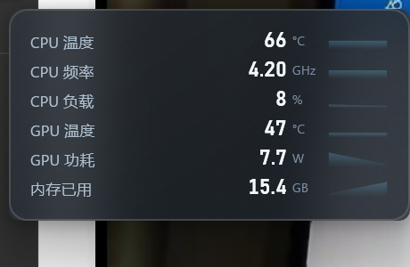
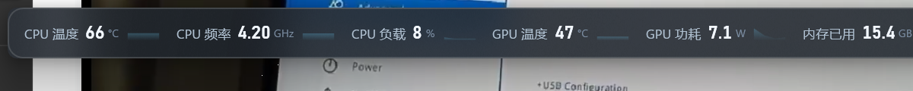
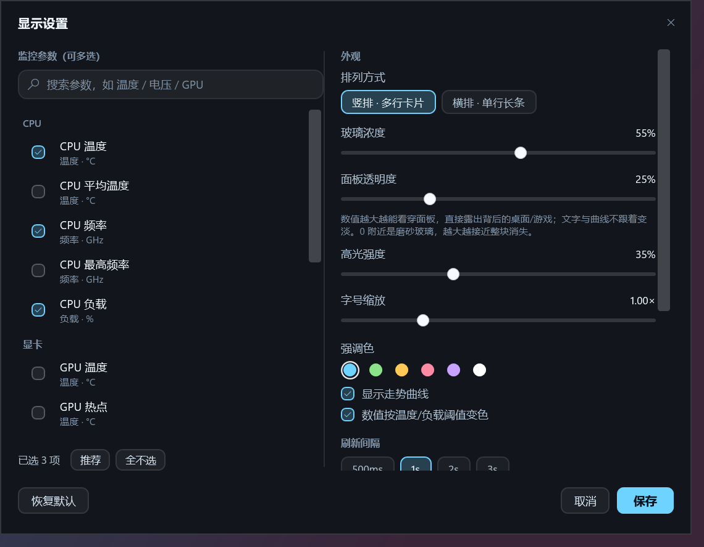
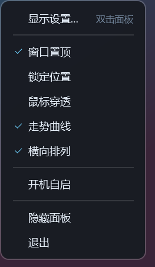
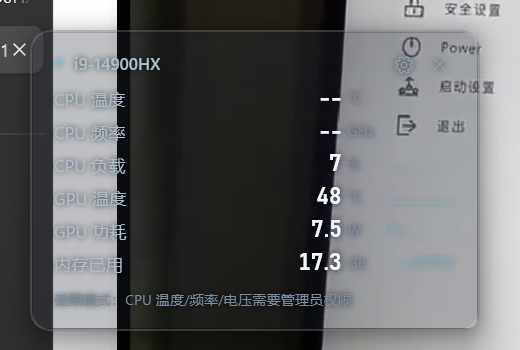

# CpuGlassMonitor · CPU 玻璃监控

透明毛玻璃风格的 CPU/GPU 硬件监控悬浮窗：**温度、频率、核心电压、负载、功耗、显存、内存**都能看，
参数可以自由勾选，窗口可置顶、可锁定、可鼠标穿透，带托盘常驻。

两种排布随参数多少自由切换：**竖排·多行卡片**（默认，适合贴在桌面角落）和**横排·单行长条**
（一栏到底，适合盖在屏幕顶部，参数多时自动折行）；整块面板的透明度也能单独调。

- 界面：WPF 分层窗口（`AllowsTransparency`，自绘 per-pixel alpha）+ Win11 DWM 圆角/暗色模式，
  低透明度区间叠加系统亚克力（`SetWindowCompositionAttribute`）做磨砂
- 采集：LibreHardwareMonitorLib 0.9.4（ring0 驱动读 CPU 温度/频率/电压；GPU 走 NVAPI，不需要驱动）
- 体积：发布后约 1.6 MB（框架依赖，需要已安装 .NET 10 桌面运行时）
- 语言：C# / net10.0-windows，x64






## 运行

从 [Releases](../../releases) 下载发布包直接运行，或按下面「构建 / 发布」自己编译出 `dist\`。
需要 **.NET 10 桌面运行时**（Windows 10 1809+ / Windows 11）。

> **首次启动会弹一次 UAC**。CPU 温度 / 频率 / 核心电压必须走内核驱动（ring0），没有管理员权限时
> 只能读到负载；此时面板底部会显示「受限模式」提示，同意 UAC 即可看到全部数据。
> 不想每次提权：设置里关掉「需要管理员权限」，或者启动时加 `--no-elevate`。

交互：

| 操作 | 效果 |
| --- | --- |
| 拖动面板 | 移动窗口（「锁定位置」后不可拖） |
| 双击面板 | 打开设置 |
| 右键面板 / 托盘图标 | 右键菜单（置顶、锁定、穿透、曲线、横排、自启、隐藏、退出） |
| 托盘图标单击 | 显示/隐藏面板 |
| 托盘菜单「退出」 | 完全退出程序 |

> 面板上**没有标题栏、齿轮和关闭按钮**，只有数据本身——这样能压到最窄，直接当 HUD 用。
> 设置靠双击面板（或右键菜单「显示设置…」、托盘菜单）；要关掉程序走托盘「退出」。

## 设置面板

左侧是可勾选的监控参数（按 CPU / GPU / 内存分组，支持关键字搜索），右侧是外观与行为：

- 排列方式：竖排·多行卡片 / 横排·单行长条
- 玻璃浓度（5–92%，控制玻璃底色的深浅）、面板透明度（0–92%，= 能看穿多少）、高光强度、字号缩放（0.8–1.6×）、强调色（6 种）
- 显示走势曲线、数值按阈值变色
- 刷新间隔 500ms / 1s / 2s / 3s
- 窗口置顶、锁定位置、鼠标穿透、开机自启、需要管理员权限、显示杂项传感器

「保存」写入配置，「取消」回滚；改动是**实时预览**的。

### 玻璃浓度 vs 面板透明度

两个滑杆管的是不同的事，别混着调：

| 滑杆 | 作用 |
| --- | --- |
| **玻璃浓度** | 玻璃底色本身深不深（深蓝灰 → 近黑），面板有多「沉」 |
| **面板透明度** | 能看穿多少。数值越大，背后的桌面/游戏越清楚，文字与曲线**不跟着变淡** |

透明度走的是**分层窗口的自绘 alpha**，所以是真透明：0 附近是磨砂玻璃（这一档会借系统亚克力做磨砂质感），
往右推会一层层褪掉，到 90% 以上几乎只剩文字浮在桌面上。

> 说明：Windows 有个硬限制——顶层窗口要么用系统亚克力（有真模糊，但透明度被系统锁死），
> 要么用分层窗口（透明度完全可控，但没有系统级模糊）。本程序选的是后者，因此高透明度区间
> 没有真实模糊，只有半透明蒙版；低透明度区间才切到亚克力。

面板透明度 70% 时的效果（背后是浏览器，文字仍清晰）：



## 配置文件

`%APPDATA%\CpuGlassMonitor\`

- `settings.json`：窗口位置/宽度、已选参数、外观与行为
- `app.log`：启动与异常日志（排查问题看这个）

测试时可以设置环境变量 `CPUGLASS_CONFIG_DIR` 指向别的目录，避免污染真实配置。

## 构建 / 发布

```powershell
cd src
dotnet build -c Release                                  # 编译
dotnet publish -c Release -r win-x64 --self-contained false -o ..\dist
```

`src\lib\` 里是直接引用的四个程序集（LibreHardwareMonitorLib、HidSharp、System.Management、System.IO.Ports），
所以**不需要联网还原 NuGet 包**。

调试参数（自动化验证用，正常使用不需要）：

| 参数 | 作用 |
| --- | --- |
| `--selftest` | 不开窗口，采样 8 秒后把全部传感器读数写进 `app.log` 并退出 |
| `--shot <png>` | 显示主窗口，7 秒后把窗口自身渲染成 PNG 并退出 |
| `--shot-settings <png>` | 同上，但渲染设置面板 |
| `--shot-menu <png>` | 同上，但渲染右键菜单 |
| `--no-elevate` | 不尝试提权，直接以降级模式运行 |
| `--fake-temps` | 往读数里塞假温度/频率（只有界面调试用，取不到真实温度时验证样式） |

## 目录结构

```
CpuGlassMonitor/
  src/                     主程序
    Core/                  AppSettings、SettingsStore、AutoStart
    Sensors/               SensorEngine、MetricSpec（聚合指标、单位换算、阈值）
    Ui/                    MainWindow、SettingsWindow、Sparkline、Styles.xaml、托盘
    Interop/               GlassHelper（DWM 毛玻璃、鼠标穿透、隐藏 Alt+Tab）
    lib/                   四个第三方程序集
    Assets/app.ico         自绘图标（深色圆角芯片 + 青色发光轮廓）
  tools/mkicon/            图标生成器（一次性工具）
  docs/                    截图
```

## 许可

MIT，见 [LICENSE](LICENSE)。第三方组件：LibreHardwareMonitorLib（MPL-2.0）、HidSharp（Apache-2.0）。

## 已知限制

- **CPU 温度/频率/电压必须提权**，这是内核驱动的硬要求（HWiNFO、AIDA64 同理）。
- 横排单行长条在参数很多时会自动折行；如果还是太宽，会按屏幕可用宽度截断，建议少选几项。
- 独占全屏（exclusive fullscreen）的 3D 游戏可能盖住任何置顶窗口；把游戏改成「无边框窗口」即可。
- 风扇转速、CPU 电压是否有数值取决于主板传感器（笔记本一般只暴露部分传感器）。
- 部分 Intel 新平台需要 LibreHardwareMonitor 更新版本才能读到全部传感器。
